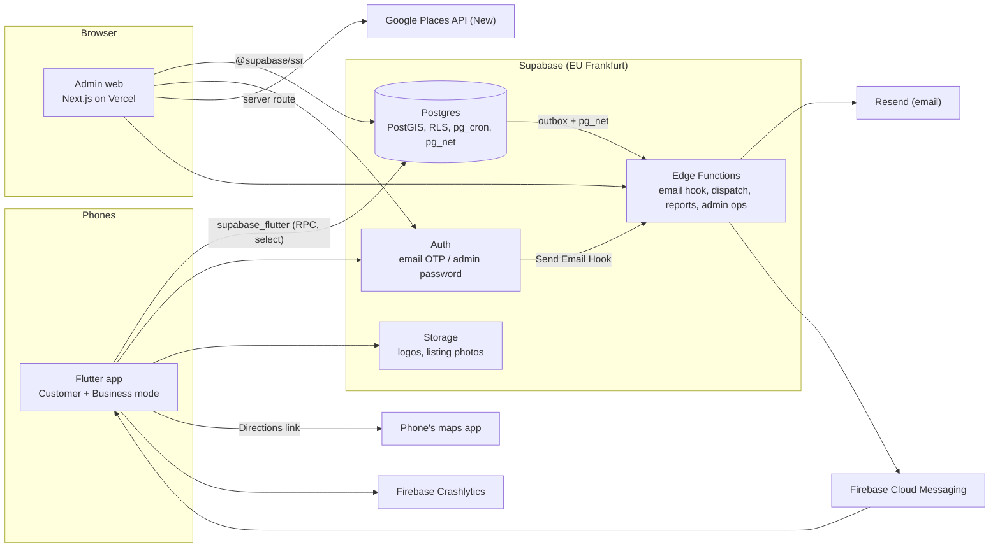
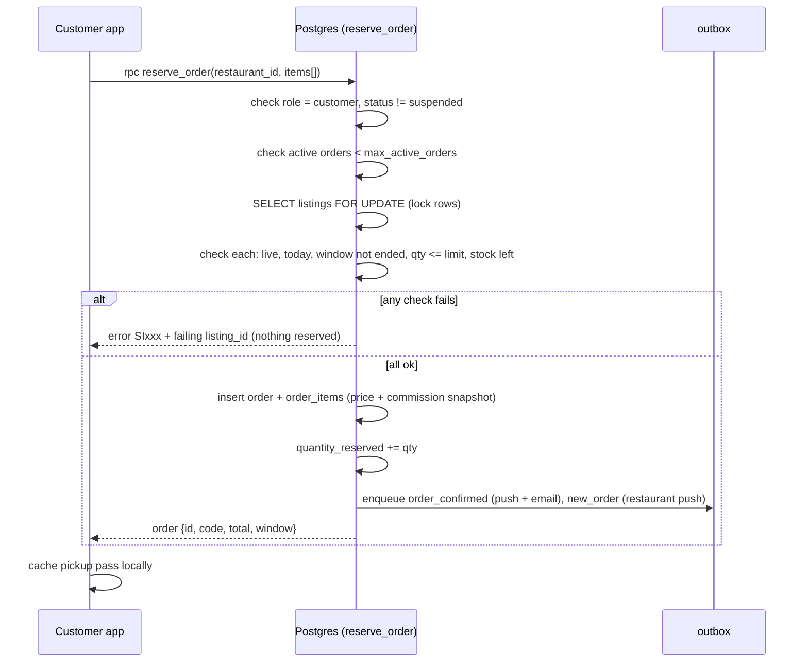
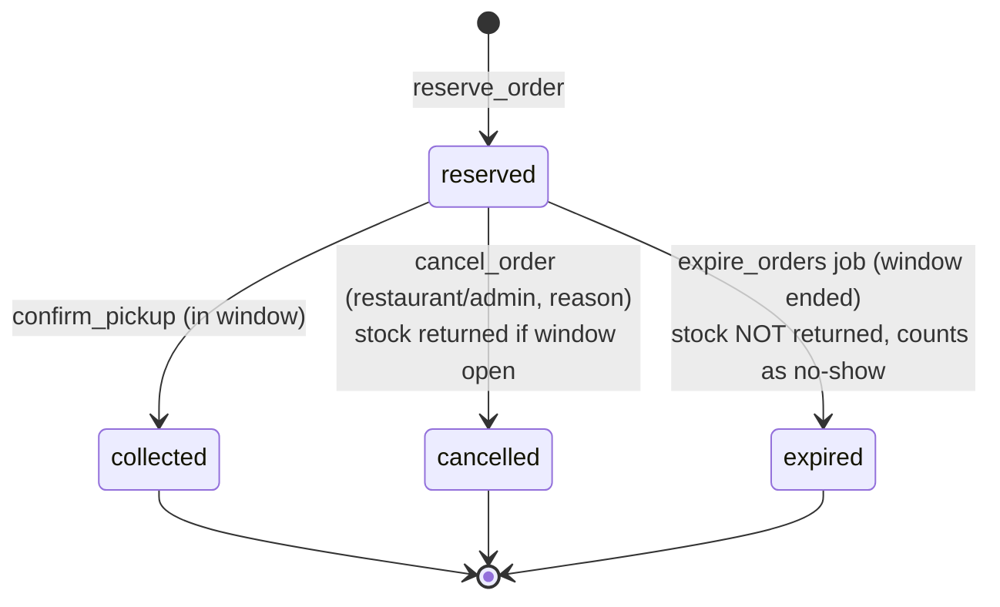

# 01. Architecture

## 1. System overview



## 2. Components

| Component | Responsibility | Key decisions |
|---|---|---|
| **Flutter app** | Customer app and restaurant Business mode, in one codebase. After login, the user's role decides which section the app opens. | Riverpod, go_router, freezed. Guests can browse without an account (anonymous access, read-only). The pickup pass is cached on the phone so it opens offline. |
| **Postgres** | All data and all business rules: stock, reservation, pickup, cancellation, expiry, no-shows, commission | State changes happen only through `SECURITY DEFINER` RPCs that check the caller's role. Row-level security on every table. PostGIS for distance. |
| **Auth** | Customers and restaurants log in with a 6-digit email code. Admins log in with email and password. | Supabase Auth email OTP. The Send Email Hook sends codes through Resend and enforces the 3-codes-per-hour limit. |
| **Edge Functions** | Work that needs secrets or the Auth admin API, or produces files: email hook, notification dispatch, creating restaurants and admins, account deletion, payout PDF and CSV | Deno and TypeScript. Secrets are stored in Supabase secrets. |
| **pg_cron jobs** | Expire orders after the pickup window, send pickup reminders, drain the notification outbox | Run every 1–5 minutes. Every job can safely run twice without side effects (idempotent). |
| **Admin web** | Restaurants, customers, orders, admins, CSV export, address search | Next.js App Router, shadcn/ui. Every page is checked server-side for the admin role. The Google key is used only on the server. |
| **Storage** | Restaurant logos (written by admins) and listing photos (written by restaurants) | Public-read buckets. Writes are limited by path prefix. Images are resized on the phone before upload. |

## 3. Roles and access

| Role | How the account is created | Login | Sees |
|---|---|---|---|
| Guest | — (anonymous) | — | Public restaurant and listing data only, through RPCs |
| Customer | Created on first email-code sign-in; completes the profile (name, phone, terms) before the first reservation | Email code | Own profile and own orders |
| Restaurant | An admin creates it through the `admin-create-restaurant` function | Email code (no self sign-up) | Own restaurant, listings, pickup windows, orders, reports |
| Admin | The first admin is seeded by the developer; after that, any admin can create others, deactivate them and reset their passwords | Email and password (changeable by the admin) | Everything |

The role is stored in `profiles.role`. It is also copied into the JWT `app_metadata.role` claim when the user is created, so RLS policies can read it cheaply.

## 4. Key flows

### 4.1 Reserve (CA-10, CA-11)



### 4.2 Pickup (BM-09)

The restaurant scans the QR code or types the code. `confirm_pickup(code)` then checks four things:
- the order belongs to the caller's restaurant
- the order is still `reserved`
- the current time is within the window (Asia/Dubai)
- if all pass, it sets `collected` and `collected_at`

It returns a result type that the app shows as Success, Invalid, Already collected, Expired or Cancelled.

### 4.3 Order lifecycle (SR-03, SR-04, SR-05)



### 4.4 Notifications

Business events insert rows into `outbox`, in the same transaction as the change. A pg_cron job runs every minute: it calls the `dispatch` Edge Function through pg_net, which sends push (FCM) and email (Resend) and marks each row sent or failed. Failed rows are retried with backoff up to 5 times. See [06-notifications.md](06-notifications.md).

## 5. Time and "today"

- **Single time zone:** all business rules use Gulf Standard Time (`Asia/Dubai`, UTC+4, no daylight saving). This covers "today" for listings and pickup windows, the expiry check and report months.
- **`app_today()`** returns `(now() at time zone 'Asia/Dubai')::date`. It is used by every rule that needs today's date.
- **Pickup windows** store full `timestamptz` start and end times, so comparisons never depend on the phone's clock.
- **Overnight opening hours:** if `closes_at` is earlier than `opens_at` (for example 12:00–01:00), the restaurant closes after midnight. Pickup windows still end by 23:59 the same day (SR-02).

## 6. Security model (NF-05)

- **Encryption:** all traffic is HTTPS.
- **Keys in the app:** the anon key ships in the app. It is safe only because RLS and the role checks inside RPCs protect the data.
- **Service-role key:** it never leaves Edge Functions or Next.js server code.
- **Writes:** clients can write directly only to their own profile fields, their device tokens, and their restaurant's listings and pickup windows (restaurant role), all limited by RLS. Everything else goes through RPCs.
- **Google key:** the Google Places key is restricted to the Places API (New) and kept server-side in Next.js. The app has no Google key.
- **Admin passwords:** at least 12 characters, handled by Supabase Auth.
- **Audit log:** admin actions are written to `audit_log`: suspend, lift, cancel, create restaurant, create admin.
- **Personal data:** only what Section 7 of the SRS lists. Account deletion anonymises orders: `customer_id` becomes null and the snapshot name becomes "Deleted customer".

## 7. Environments

There are two hosted environments and no local Supabase stack on the developer's PC (Windows). Database tests run in CI on a temporary stack inside the GitHub runner.

| Env | Supabase | Firebase | Admin | App flavor | Bundle / package ID | Distribution |
|---|---|---|---|---|---|---|
| dev | Project `saveit-dev`, Free plan (separate free org), Frankfurt | saveit-dev | Vercel deployment from `main` | `dev` | `<prefix>.saveit.dev` | Android: Firebase App Distribution. iOS: TestFlight app "Save it Dev" |
| prod | Project `saveit-prod`, client's Pro org, Frankfurt | saveit-prod | Vercel production (custom domain) | `prod` | `<prefix>.saveit` | Google Play and App Store |

- **App IDs:** the bundle ID prefix (for example `org.arisehub`) is agreed with the client in T01.2.
- **Dev pauses:** a Free-plan project pauses after a week with no activity, so restore it before demos and the beta.
- **Separate free org for dev:** keeping dev outside the Pro org stops it from adding compute charges to the client's bill.
- **Production on Pro:** it needs the Pro plan for daily backups, for the session inactivity timeout (30 days, CA-04), and so it never pauses.
- **Pipelines:** how code reaches each environment is in [13-ci-cd.md](13-ci-cd.md).

## 8. Repository layout

```
saveit/
├── CLAUDE.md
├── README.md
├── .github/workflows/          ci.yml, deploy-backend.yml, android.yml
├── codemagic.yaml              iOS builds (ios-dev, ios-release)
├── app/                        Flutter (see 04-mobile-app.md)
├── admin/                      Next.js (see 05-admin-web.md)
├── supabase/
│   ├── config.toml
│   ├── migrations/             YYYYMMDDHHMM_name.sql
│   ├── functions/              one folder per Edge Function, _shared/ for helpers
│   ├── tests/                  pgTAP *.test.sql
│   └── seed.sql                sample data for dev (run manually)
└── docs/
```
